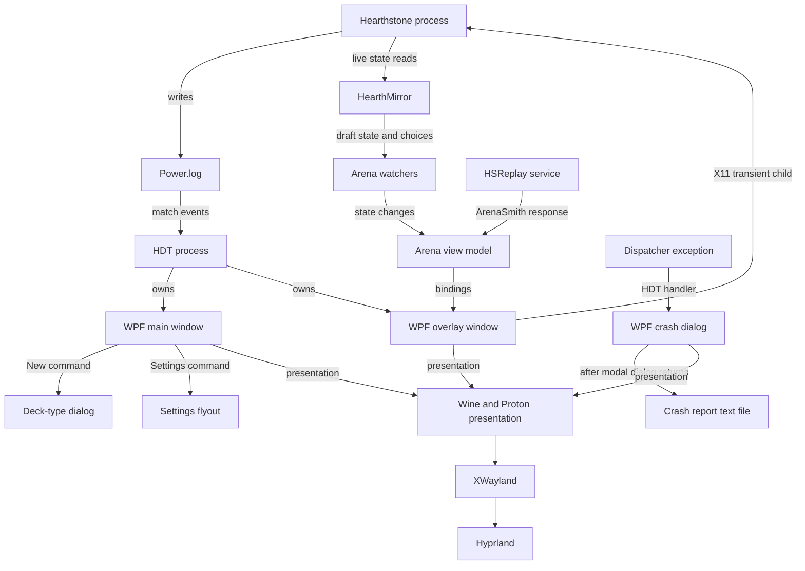

# HDT windows, state, and failure observations

This map describes the components relevant to the white-window investigation. It is not a complete state space of HDT. Runtime observations apply to the tested configuration in the [compatibility record](COMPATIBILITY.md#tested-environment).

## Component relationships

The diagram combines live observations, project source, and inspected upstream source. The table below identifies those boundaries. An arrow does not establish that the component currently makes progress.

## Ownership and evidence

| Component | Owned state and observations | Evidence and limits |
|---|---|---|
| Hearthstone | Actual game scene and choices | A separate live process. The operator controls all entry, picks, and game window changes |
| HDT main window | Deck selection, commands, and flyouts | WPF runtime identified `MainWindow` with `AllowsTransparency=false` |
| Overlay | Arena visuals, deck visuals, and marked interactive controls | WPF runtime identified `OverlayWindow` with `AllowsTransparency=true`. It is a separate native window in the HDT process |
| Popup and tooltip hosts | Temporary visual roots | Some WPF popups have a separate presentation source. A complete inventory of HDT popup types and creation paths is not established |
| Crash dialog | Error display and modal lifetime | Runtime identified `CrashDialog`. REA inspection of the installed handler confirms that `ShowDialog` precedes report-file creation and writing. A stuck dialog can therefore prevent a fresh report file |
| Arena watchers | Cached draft state and emitted changes | Installed `HearthWatcher.dll` contains `PollingWatcher.RunLoopAsync` and `Dispatch`. Method inventory alone does not prove a running watcher remains healthy |
| Arena view model | Detected choices, availability, ratings, and visibility | Exported state can show the view model and visual as active. That does not establish that choices or ratings match the current offer |
| Arena score particles | Cosmetic 3D particle systems on level-five badges | Isolated replay reproduced `88980406` with particles and passed when their initialization was suppressed. Plugin 0.5.0 applies that workaround. Scores and badge artwork remain enabled |
| Compatibility plugin | Geometry refresh, input rectangles, and diagnostic observations | [Plugin source](../src/plugin/ProtonCompatibility.cs). The plugin does not make additional HearthMirror queries |
| Input bridge and Hyprland rules | Validated rectangles, overlay focus permission, and stacking | [Bridge](../src/host/control.rs) and [rules](../src/hyprland/overlay-rules.lua). Game state is not their source of truth |
| Proton presentation | Windows graphics and window calls | The tested HDT process loaded native CLR and Direct3D components. Component loading does not identify the defective call |

## Independent state dimensions

### Overlay views and update paths

The overlay is one window with several views. Classify a test by its update path as well as its visible screen.

| View | Updates to distinguish | Observed status |
|---|---|---|
| Menus and configuration | Scene changes, selected deck, Settings, and other main-window commands | Settings works at the main menu and Battlegrounds menu, according to the operator |
| Standard match | Live match events and the displayed deck | Saved Standard results verified. This does not cover every overlay control |
| Battlegrounds match | Live match state and mode-specific visuals | Operator reports working overlay and main-window interaction during play |
| Arena match | Live match events and the drafted deck | Two later match results verified. Match tracking does not establish draft tracking |
| Arena draft | Successive offers, picks, ratings, and departure from drafting | Operator reports the first offer appears, then previous ratings persist and main-window controls become unresponsive |

This comparison concentrates the investigation on Arena draft transitions. It does not yet establish whether the failure begins in a watcher, ratings work, a UI callback, or presentation. White main and crash windows remain separately observed symptoms.

The later corrected replay isolated a presentation failure in the level-five score particle path. Internal card models advanced while pixels remained on the first offer, so the earlier stale display did not prove stalled watcher events. After the particle workaround was installed, the operator confirmed multiple live offer updates and responsive main-window controls. This establishes the tested workaround, not the absence of other watcher or rendering defects.

The relevant test state is a combination of dimensions, rather than a single Arena-mode flag.

| Dimension | Values relevant to this investigation |
|---|---|
| Game scene | Main menu, Arena lobby, draft offer, pick transition, match |
| Draft data | Current choices, previous choices, ratings pending, current ratings, failed request |
| HDT action | No action, focus only, New, Settings, resize, toggle floating |
| Window kind | Main window, overlay, flyout, popup root, crash dialog |
| Input | Game active, main active, overlay control active, modal dialog active |
| Presentation | Rendering normally, stale pixels, white content, rendering exception |

These values define a bounded test inventory. They are not an exhaustive enumeration or a model-checking result.

The live presentation snapshot at 18:18 Europe/Oslo placed the main window and overlay on dispatcher thread 1, with the process preference set to `SoftwareOnly`. Both targets reported `Default`. Microsoft documents that the process preference takes precedence over the target preference, so those values do not establish a missing per-window software setting. This observation does not cover every popup or future dialog.

## Observed transitions

| Transition | Observation | Remaining question |
|---|---|---|
| Open and close Settings at the main menu | Operator confirmed Settings works | Does the same action fail consistently during drafting? |
| Enter draft without another HDT action | One controlled attempt stayed normal | Does the result repeat? |
| Pick a card | Operator reported previous-offer ratings on the next offer | Did the watcher, view model, rating request, or presentation stop updating? |
| Focus main window during draft | No immediate white content, but operator reported unresponsive controls | Was a modal or rendering failure already pending? |
| Press New during draft | Operator reported a crash | Does New fail outside Arena? |
| Press Settings repeatedly during draft | Captured `COMException` with HRESULT `88980406` | Where did the rendering failure originate? |
| Toggle floating during draft | Operator reported white main and crash windows | Does a geometry change reproduce outside Arena? |
| Display crash dialog | White, unusable dialog while Arena overlay remained drawn | Is the overlay still repainting, or displaying its last successful content? |

Microsoft documents one render thread per WPF process and explains that a modal dialog can continue to dispatch work. A rendering failure can be reported later when a window updates its settings. The managed stack identifies the observation point, not necessarily the initiating operation. See [WPF render-thread failures](https://learn.microsoft.com/en-us/troubleshoot/developer/dotnet/framework/general/wpf-render-thread-failures) and [WPF threading and nested pumping](https://learn.microsoft.com/en-us/dotnet/desktop/wpf/advanced/threading-model#nested-pumping).

## Diagnostic boundaries

`presentation-state.json` describes the WPF presentation roots visible to the plugin at the sampling instant. It records root types, dispatcher thread identities, dimensions, and requested per-target render modes. A `Default` target mode does not establish hardware rendering. The process preference and target preference are separate fields.

`dispatcher-failures-<pid>.jsonl` retains the first 32 exception observations in order within a process. Each entry includes HRESULTs and method names. A later crash-dialog failure does not overwrite the initiating exception. Exception messages, arguments, account data, and card identities are excluded.

The existing `input-region.json` describes cached HDT state and control rectangles. Fresh timestamps establish that the exporter ran. They do not establish watcher progress, correct ratings, completed commands, or healthy rendering. A modal dispatcher can keep the exporter running.

All diagnostic files remain in the private `evidence` directory. Neither a missing exception record nor a static overlay establishes healthy rendering. Visual repainting, input handling, choice detection, and rating responses require separate observations.

See [freeze diagnostics](DIAGNOSTICS.md) for the local flight recorder, `hdt-proton trace-export`, and the replay `--diagnostics` option.
